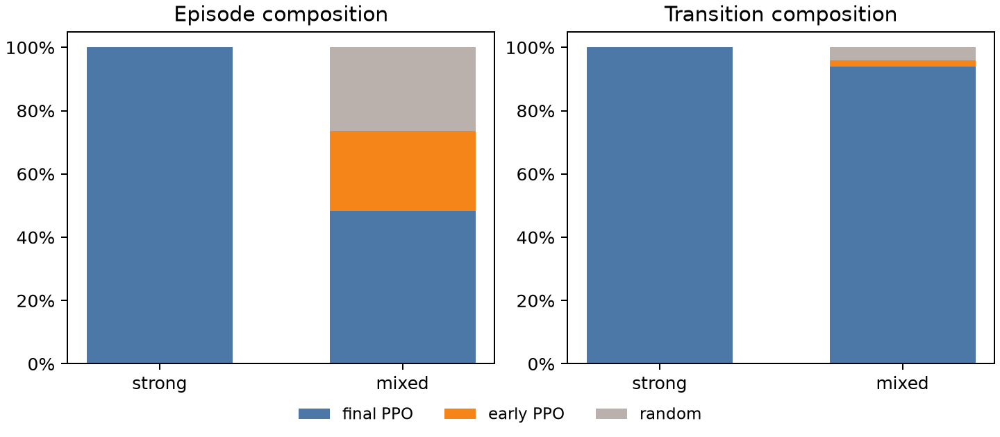

# cql-minigrid

**Team 12 — Reinforcement Learning.** PyTorch implementations of offline DQN,
discrete Conservative Q-Learning (CQL), and behavioral cloning (BC) for
`MiniGrid-Dynamic-Obstacles-8x8-v0`. PPO supplies the recorded experience.
[Presentation.pdf](docs/Presentation.pdf) defines the requirements;
[the requirements map](docs/proposal_requirements.md) links slides to implementation.

The retained 50,000-transition pilot contains 18 runs: three methods × two frozen
datasets × three training seeds. Every run uses 5,000 updates and the same
100 held-out evaluation seeds. Compact results, plots, and replay GIFs are
versioned here; datasets, model weights, and full episode logs stay local.

## Pilot results (approximately 50,000 transitions)

Values are mean ± **sample standard deviation across three training seeds**
(0, 1, 2). Rates first come from 100 episodes per run; error bars describe
training-seed variation, rather than uncertainty over pooled episodes.

| Dataset | Method | Success % | Collision % | Return |
|---|---|---:|---:|---:|
| strong | DQN | 0.0 ± 0.0 | 100.0 ± 0.0 | -1.000 ± 0.000 |
| strong | CQL | 57.0 ± 5.3 | 21.3 ± 3.1 | 0.234 ± 0.054 |
| strong | BC | 53.3 ± 9.8 | 20.7 ± 5.9 | 0.216 ± 0.021 |
| mixed | DQN | 12.0 ± 19.9 | 48.0 ± 19.5 | -0.368 ± 0.219 |
| mixed | CQL | 62.0 ± 4.0 | 16.3 ± 0.6 | 0.332 ± 0.042 |
| mixed | BC | 57.7 ± 10.1 | 21.0 ± 1.0 | 0.256 ± 0.075 |


CQL has the highest mean success and return on both files. Its success
advantage over BC is 3.7 percentage points on `strong` and 4.3 on `mixed`,
which is small compared with the observed seed variation. Three seeds do
not establish a general advantage over BC. DQN reached no successes on
`strong`; on `mixed` it averaged 12% with substantial variation across seeds.

All three methods had higher mean success on `mixed` in these runs. This
setting varies coverage as well as source quality: failed early/random
trajectories add actions and negative outcomes, and 93.9% of mixed
**transitions** still come from final PPO. The comparison does not isolate
the causal effect of lower-quality data. It uses one collector seed, one
frozen file per condition, one CQL alpha (1.0), and one update budget.

Final PPO reached 62% success, 19% collision, and mean return 0.312 on the
same 100 held-out seeds. Early PPO and random each had 0% success and 100%
collision. These collector references use one checkpoint each and have no
training-seed error bars.

[Per-run CSV](reports/pilot-50k/per_run.csv), [full compact report](reports/pilot-50k/summary.json),
and [hardware/build details](reports/pilot-50k/runtime.json) retain the measured values.
[The artifact audit](reports/pilot-50k/integrity.json) verified both datasets, all 18
checkpoints, 1,800 evaluation episodes, and six replays.
Timeout rates and steps on successful episodes are included in the JSON/CSV.

## Install and check

Run commands from the repository root with **Python 3.12**:

```sh
python3.12 -m venv .venv
.venv/bin/python -m pip install torch==2.14.1 --index-url https://download.pytorch.org/whl/cpu
.venv/bin/python -m pip install -e '.[dev]'
.venv/bin/python -m cql_minigrid doctor
.venv/bin/python -m pytest -q
```

The project's `.venv` is ready on the development machine. Recorded runs
used CPU on an Intel i7-12650H with PyTorch 2.14.1+cu130; CUDA was unavailable.
CI installs the CPU wheel and runs tests plus a complete small pipeline.
Package versions and the experiment source hashes are stored in the report.

## Environment and data

The agent receives the full symbolic grid (object one-hot, normalized
color/state), direction one-hot, and elapsed time: 837 float32 values. The named `elapsed_steps` component is encoded as
`elapsed_steps / 256` at index 836, and reset/step info retains the integer counter.
`configs/observation.json` defines the shared interface. Actions are left,
right, and forward. The original 256-step horizon and rewards are retained
for collection and evaluation: ordinary step 0, collision -1, and success
`1 - 0.9 * steps / 256`. A blocked forward action includes walls.

Success, collision, and timeout are distinct. Datasets retain both
`terminated` and `truncated`; if both are true, terminal success/collision
wins over timeout in outcome counts. The final next observation is stored,
without substituting an observation from the next episode.

PPO alone trains with
`original_reward + 0.2 * (distance_before - distance_after) - 0.005`, using
Manhattan distance to the goal. Its time limit is terminal for the value
target. This collector reward was chosen using validation; saved data and
all reported evaluations use the original rewards. Two 401,408-step pilots
(unshaped and potential-only) each had 0/64 validation successes; their logs
remain under `artifacts/pilots/`.

The early PPO checkpoint has 10,240 steps and the final one 401,408
(configured targets 10,000 and 400,000 round to complete PPO rollouts).
Before collection, final PPO reached 41/64 validation successes (64.06%);
early PPO and random each reached 0/64. Collection requires at least 60%
validation success for the final source.

| Retained pilot file | Transitions | Episodes | Episode success | Episode collision | Episode timeout | Mean return |
|---|---:|---:|---:|---:|---:|---:|
| strong | 50,058 | 488 | 62.9% | 21.5% | 15.6% | 0.251 |
| mixed | 50,209 | 954 | 31.6% | 60.5% | 8.0% | -0.369 |

`mixed` chooses sources per episode with probabilities 0.50 final PPO,
0.25 early PPO, and 0.25 random. The pilot episode counts are 462 / 240 / 252;
actual transition counts are 47,163 / 958 / 2,088. These proportions differ
because PPO episodes are longer. These files are pilot datasets. The [project proposal](docs/Presentation.pdf)
sets approximately 200,000 transitions per final dataset.
The final complete episode can exceed the target by up to 255 transitions.



NPZ files store observation, action, reward, next observation, both ending
flags, episode ID, source, environment seed, and policy seed. JSON metadata
records source checkpoints/hashes, actual counts, per-source outcomes, and
every episode's provenance. Collection resumes at complete-episode shard
boundaries and rejects changed sources or configuration.

The final configuration targets 200,000 transitions per dataset. Final files
and runs live under `artifacts/final/`; the 50,000-transition pilot remains
unchanged under `artifacts/main/`, with compact reports in
`reports/pilot-50k/`. `configs/pilot_50k.json` retains its collection budget.
The separate small CPU pilot remains in `configs/smoke.json`.
New transitions store `elapsed_steps` and `next_elapsed_steps` as int32;
loading old pilot files derives these counters without rewriting them.

## Reproduce

The final report includes success, collision, timeout, return, and mean steps
on successful episodes. PPO collector references use the same test seeds.
Gameplay is exported as H.264/yuv420p MP4 and GIF with separate metadata.

```sh
.venv/bin/python -m cql_minigrid replay --method ppo --format mp4 --output artifacts/final/replays/ppo-collector.mp4
```

Run the entire main pipeline, including collector training if absent:

```sh
.venv/bin/python -m cql_minigrid pipeline --config configs/main.json --root artifacts/final --workers 1 --reports reports
```

Or run each phase explicitly:

```sh
.venv/bin/python -m cql_minigrid ppo --config configs/main.json --root artifacts/final
.venv/bin/python -m cql_minigrid collect --config configs/main.json --root artifacts/final
.venv/bin/python -m cql_minigrid train --method dqn --dataset artifacts/final/datasets/strong.npz --seed 0
.venv/bin/python -m cql_minigrid train --method cql --dataset artifacts/final/datasets/strong.npz --seed 0
.venv/bin/python -m cql_minigrid train --method bc --dataset artifacts/final/datasets/strong.npz --seed 0
.venv/bin/python -m cql_minigrid experiments --config configs/main.json --root artifacts/final --workers 1 --reports reports
.venv/bin/python -m cql_minigrid evaluate --method cql --checkpoint artifacts/final/runs/strong/cql/seed-0.pt --output artifacts/final/evaluation/strong-cql-0.json
.venv/bin/python -m cql_minigrid replay --method cql --checkpoint artifacts/final/runs/strong/cql/seed-0.pt --output artifacts/final/replays/strong-cql-0.gif
```

The `experiments` command completes/resumes all 18 runs from existing
frozen datasets. The final matrix runs one CPU worker with one thread to bound memory use.
For manual training, repeat the commands with seeds 1 and 2 and the mixed
file, or let `experiments` handle the matrix. Add `--resume` when manually
continuing a PPO or offline training command. `--method ppo` evaluates the
final collector; `--method random` requires no checkpoint.

`configs/seeds.json` separates PPO, collection, validation, and evaluation
seeds. Validation seeds are 10000–10063, final evaluation seeds 20000–20099,
and dataset environment seeds start at 1000000 / 1100000. Evaluation seeds
are checked against validation, PPO, and recorded collection seeds.

DQN and CQL share a two-layer 128-unit ReLU Q-network, Adam (learning rate
0.0003), batch size 256, gamma 0.99, Huber TD loss, and a target copy every
250 updates. Both ending flags mask the bootstrap for this observed finite
horizon. Tests also cover continuing-task bootstrapping on truncation.
CQL adds `alpha * mean(logsumexp(Q(s, all_actions)) - Q(s, recorded_action))`
with stable `torch.logsumexp`; DQN applies alpha=0. BC uses the same network
width and update budget with cross-entropy on recorded actions.

Offline updates never reset or step the environment. Atomic checkpoints
save model, optimizer, update count, batch sampler and Python/NumPy/PyTorch
RNG state, plus the target network for Q-learning. Resume tests reproduce
uninterrupted parameters and loss history exactly on CPU. PPO restores its
optimizer but restarts environment episodes, so resumed PPO is not bitwise
equivalent to uninterrupted collection-policy training.

## Pilot, checks, and artifacts

```sh
.venv/bin/python -m cql_minigrid pipeline --config configs/smoke.json --root artifacts/proposal-smoke --reports artifacts/proposal-smoke/reports
```

The measured full CPU pilot took 7.23 seconds (six small runs). A three-worker
resume took 5.87 seconds and kept all six checkpoints and metric summaries
unchanged. The representative 100-update DQN pilot took 0.31 seconds for
updates, 1.52 seconds including dataset/model setup; it continued into the
main seed-0 run. Final PPO's timer recorded 111.28 seconds; the 50,000-transition pilot matrix
recorded 130.62 seconds with three workers, including evaluation and replay
export. Imports/setup outside each timer are excluded.

Local pytest and CI cover seeded observations, ending priority, TD masks,
known CQL values, alpha=0 loss/gradient equality, exact offline resume,
dataset checksums, replay/metric agreement, and sample-SD aggregation.
The small pipeline disables the collector quality gate. Full training runs
locally; GitHub Actions uses `configs/smoke.json`.

| Local path | Contents |
|---|---|
| `artifacts/final/datasets/` | Frozen NPZ/JSON files and resumable shards |
| `artifacts/final/ppo/` | Early/latest/final PPO checkpoints and learning history |
| `artifacts/final/runs/{dataset}/{method}/seed-{seed}.pt` | Offline checkpoints |
| `artifacts/final/runs/` | Per-run training and 100-episode evaluation JSON |
| `artifacts/final/replays/` | Replay GIFs and episode metadata |
| `artifacts/final/results.json` | Complete matrix summaries and experiment provenance |
| `artifacts/final/*.log` | Main PPO, collection, and experiment logs |
| `artifacts/full-pilot/`, `artifacts/pilots/` | Pilot timings and failed collector diagnostics |
| `reports/` | Compact tracked tables, plots, runtime details, and demonstrations |

Retained pilot dataset SHA-256 values:

```text
strong 9996626ec7abf42ca1be736f9e96e9917fc81fb40748a76d95e8e261c8fcbc11
mixed  7cb0d7376dc0c7dfb0fb76c09779477ed453609465b5af90edc1c74095f42d3a
```

The experiment report records the exact implementation revision and hashes.
`reports/rendering.json` separately records the final plot renderer and its
input-results hash; moving legends after the run changes presentation only.

## Demonstrations

All six GIFs show training seed 0 and evaluation seed 20000. They include
failures; every ending is labeled here and retained in its adjacent JSON.
Subsampled playback lasts about ten seconds or less.

| Dataset | DQN | CQL | BC |
|---|---|---|---|
| strong | [collision](reports/pilot-50k/demos/strong-dqn.gif) | [collision](reports/pilot-50k/demos/strong-cql.gif) | [collision](reports/pilot-50k/demos/strong-bc.gif) |
| mixed | [collision](reports/pilot-50k/demos/mixed-dqn.gif) | [success](reports/pilot-50k/demos/mixed-cql.gif) | [success](reports/pilot-50k/demos/mixed-bc.gif) |


