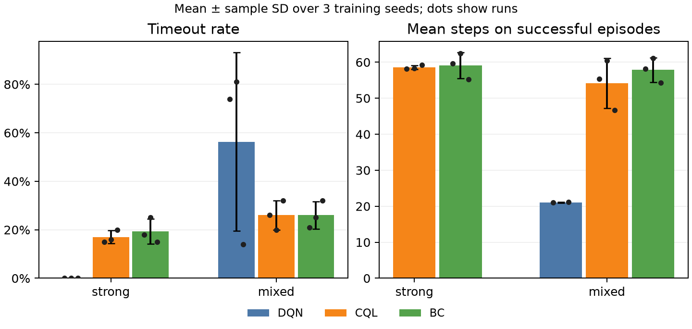
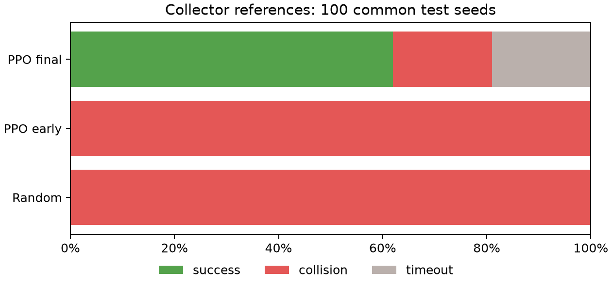
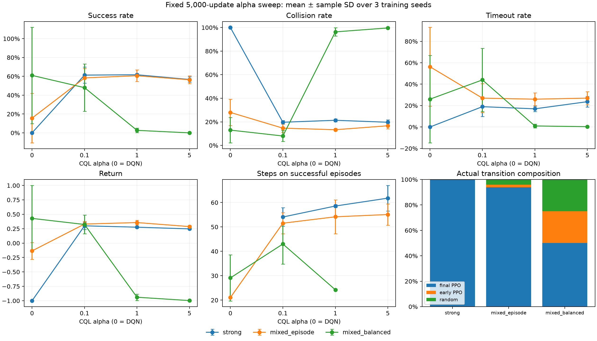
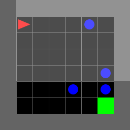

# cql-minigrid

**Team 12 — Reinforcement Learning.** PyTorch implementations of offline DQN,
discrete Conservative Q-Learning (CQL), and behavioral cloning (BC) for
`MiniGrid-Dynamic-Obstacles-8x8-v0`. PPO supplies the recorded experience.
[Presentation.pdf](docs/Presentation.pdf) defines the project requirements;
[the requirements map](docs/proposal_requirements.md) links slides to implementation.

The final experiment uses **200,035 strong transitions and 200,019 mixed
transitions**, with 18 fresh offline runs: three methods × two frozen datasets
× three training seeds. Each run has 5,000 updates and 100 common held-out test
episodes. Reports include all five proposal metrics, PPO collector references,
and MP4/GIF gameplay. The 50,000-transition pilot and the small CPU pilot are retained.

A separate [mixed-data and alpha study](docs/ablation.md) adds a transition-balanced
mixed file and 39 runs with alpha values 0, 0.1, 1, and 5. Original results below
remain available for comparison.

## Final results

Values are mean ± **sample standard deviation across training seeds 0, 1, 2**.
Each run first computes its metrics on test seeds 20000–20099; error bars
represent variation across training seeds. They are not confidence intervals.

| Dataset | Method | Success % | Collision % | Timeout % | Return | Successful steps |
|---|---|---:|---:|---:|---:|---:|
| strong | DQN | 0.0 ± 0.0 | 100.0 ± 0.0 | 0.0 ± 0.0 | -1.000 ± 0.000 | — |
| strong | CQL | 61.7 ± 1.5 | 21.3 ± 1.2 | 17.0 ± 2.6 | 0.276 ± 0.004 | 58.6 ± 0.6 |
| strong | BC | 58.3 ± 5.0 | 22.3 ± 0.6 | 19.3 ± 5.1 | 0.239 ± 0.047 | 59.1 ± 3.6 |
| mixed | DQN | 15.7 ± 26.3 | 28.0 ± 11.1 | 56.3 ± 36.8 | -0.135 ± 0.146 | 21.1 ± 0.1 |
| mixed | CQL | 60.7 ± 6.1 | 13.3 ± 1.2 | 26.0 ± 6.0 | 0.357 ± 0.039 | 54.2 ± 6.9 |
| mixed | BC | 55.0 ± 4.6 | 19.0 ± 2.0 | 26.0 ± 5.6 | 0.248 ± 0.037 | 57.9 ± 3.4 |

Successful steps means episode length conditional on success, averaged across
runs with successes. `mixed` DQN has two such runs; `strong` DQN has none
(`—`). The JSON records these valid-seed counts. Every other metric uses all
three runs. Rates may not sum to exactly 100% after rounding.




CQL has the highest mean success and return on both datasets. Its success
advantage over BC is 3.3 percentage points on `strong` and 5.7 on `mixed`;
three seeds and the observed variation do not establish a general advantage.
DQN fails on `strong` and varies substantially across seeds on `mixed`.

For CQL, `mixed` reduces collision by 8 percentage points and increases timeout
by 9 points relative to `strong`, while success decreases by 1 point and return
increases by 0.081. A timeout returns zero while a collision returns -1, so the
higher return coexists with more timeouts. BC also has lower mean success on
`mixed`. This experiment varies source quality and action coverage together:
93.8% of mixed transitions still come from final PPO. It uses one collector
training seed, one frozen file per condition, one CQL alpha (1.0), and one
update budget; it does not isolate a causal effect of lower-quality data. The
follow-up study varies alpha and includes mixed data with approximately
50%/25%/25% transitions from final PPO, early PPO, and random.

## Collector reference on the same test seeds

These references use the exact same 100 held-out seeds as every offline run.
Each source has one checkpoint or policy, so no training-seed error bars apply.

| Collector reference | Episodes | Success % | Collision % | Timeout % | Return | Successful steps |
|---|---:|---:|---:|---:|---:|---:|
| PPO final | 100 | 62.0 | 19.0 | 19.0 | 0.312 | 54.3 |
| PPO early | 100 | 0.0 | 100.0 | 0.0 | -1.000 | — |
| Random | 100 | 0.0 | 100.0 | 0.0 | -1.000 | — |



[Per-run CSV](reports/per_run.csv), [collector reference CSV](reports/collector_reference.csv),
[full compact report](reports/summary.json), and [runtime details](reports/runtime.json)
retain the measured values. The [artifact audit](reports/integrity.json) verifies
both final files, 18 checkpoints, 1,800 offline evaluation episodes, 300 reference
episodes, all five metric aggregates, and seven MP4/GIF replay pairs.

## Environment, rewards, and frozen datasets

All methods receive the full 8×8 symbolic grid (object one-hot plus normalized
color/state), direction one-hot, and the named `elapsed_steps` component:
837 float32 values. `elapsed_steps / 256` occupies index 836;
reset/step info also exposes the integer counter, from 0 to 256.
[configs/observation.json](configs/observation.json) defines this shared schema.
The three actions are left, right, and forward.

The slide 5 reward and ending rules apply to collection and evaluation:
ordinary step reward 0; goal reward `1 - 0.9 * elapsed_steps / 256`;
blocked forward action, including a wall, reward -1 and collision termination;
timeout truncation at 256 steps. Success, collision, and timeout are distinct.
If `terminated` and `truncated` are both true, success/collision takes priority
over timeout. Data preserves both flags and the actual final next observation.

| Final file | Transitions | Episodes | Success | Collision | Timeout | Mean return | Successful steps |
|---|---:|---:|---:|---:|---:|---:|---:|
| strong | 200,035 | 2,018 | 65.1% | 20.0% | 14.9% | 0.288 | 71.4 |
| mixed | 200,019 | 3,785 | 31.8% | 60.3% | 8.0% | -0.365 | 72.1 |

The target is approximately **200,000 transitions per final file**. Collection
finishes the last complete episode, allowing an overrun of up to 255 transitions.
`strong` uses final PPO only. `mixed` samples final PPO / early PPO / random
per episode with probabilities 0.50 / 0.25 / 0.25. Realized episode counts are
1,848 / 984 / 953; transition counts are 187,604 / 4,085 / 8,330. Longer final
PPO episodes explain the difference between episode and transition proportions.


NPZ files store observation, action, reward, next observation, `terminated`,
`truncated`, raw int32 `elapsed_steps` and `next_elapsed_steps`, episode ID,
source, environment seed, and policy seed. JSON metadata records checkpoint
hashes, counts, source outcomes, and every episode's provenance. Collection
resumes at complete-episode shard boundaries and rejects changed sources or
configuration. The loader derives raw clocks for old pilot files without
rewriting them. [Collection evidence](reports/final_collection.json) records
final counts and hashes:

```text
strong b389e8b5f08e24d4a7d2a4000d0c6a6a9955b92fef54cc111752df0c93e42f42
mixed  fe406cc563231614bf9546e585c462b3203050b4f1c2c1ec7f937deedde7e62e
```

PPO alone trains with
`original_reward + 0.2 * (distance_before - distance_after) - 0.005`, using
Manhattan distance to the goal. Its time limit is terminal for the value target.
This collector reward was selected using validation; recorded transitions and
all reported evaluations use the original environment rewards. Two earlier
401,408-step collector pilots (unshaped and potential-only) each had 0/64
validation successes; diagnostics remain under `artifacts/pilots/`.

Early PPO has 10,240 training steps and final PPO 401,408: targets of 10,000
and 400,000 round to complete rollouts. Before collection, final PPO reached
41/64 validation successes (64.06%); early PPO and random each reached 0/64.
The final source must pass a 60% validation-success gate. The final collection
reuses these validated PPO checkpoints with identical hashes and numerical
observation encoding, recorded in `artifacts/final/collector_reuse.json`.
All 18 final offline policies were trained afresh on the 200k files.

## Mixed-data and alpha follow-up

The new file has **200,025 transitions**: 50.0262% final PPO and 24.9869%
each early PPO/random. Whole episodes are retained. The original episode-sampled
mixed file remains unchanged. The additional study contains 36 CQL runs
(three files × four alphas × three seeds) and three BC runs on the balanced file.
The following values are success %, mean ± sample SD over seeds 0, 1, 2:

| Dataset | α=0 (DQN) | α=0.1 | α=1 | α=5 |
|---|---:|---:|---:|---:|
| strong | 0.0 ± 0.0 | 61.3 ± 8.5 | 61.7 ± 1.5 | 56.7 ± 2.9 |
| mixed_episode | 15.7 ± 26.3 | 58.3 ± 10.0 | 60.7 ± 6.1 | 56.3 ± 4.2 |
| mixed_balanced | 61.0 ± 51.1 | 48.0 ± 25.2 | 2.7 ± 2.3 | 0.0 ± 0.0 |

Balanced-data DQN has seed success rates of **91%, 90%, 2%**, so its mean has
substantial variation. Alpha 0 is the DQN control; complete parameter tensors
and metrics reproduced the original DQN/CQL controls at alpha 0/1 on both old
files. Alpha values were fixed before the study; these common-test-seed results
do not select a new default. The default remains alpha 1.

At alpha 1, changing the mixed file from episode sampling to transition quotas
changes mean success from 60.7% to 2.7%,
collision from 13.3% to 96.3%,
timeout from 26.0% to 1.0%,
and return from 0.357 to -0.939.
BC on balanced data has 0.0 ± 0.0% success.



[Study design and full results](docs/ablation.md),
[all five metrics](reports/ablation/results_table.md),
[per-run CSV](reports/ablation/per_run.csv), and
[artifact audit](reports/ablation/integrity.json) retain the details.
The audit covers 39 checkpoints, 3,900 test episodes, 300 collector-reference
episodes, and three new MP4/GIF pairs. Original proposal and pilot reports
retain their own implementation provenance.

## Install and reproduce

Run commands from the repository root with **Python 3.12**:

```sh
python3.12 -m venv .venv
.venv/bin/python -m pip install torch==2.14.1 --index-url https://download.pytorch.org/whl/cpu
.venv/bin/python -m pip install -e '.[dev]'
.venv/bin/python -m cql_minigrid doctor
.venv/bin/python -m pytest -q
```

`imageio-ffmpeg` supplies FFmpeg for MP4 export. Training uses CPU; the recorded
machine is an Intel Core i7-12650H. Its installed PyTorch build is
`2.14.1+cu130`, with CUDA unavailable. One worker and one PyTorch thread bound
memory use. The default artifact root is `artifacts/final`.

Run the complete final pipeline, training PPO if its checkpoint is absent:

```sh
.venv/bin/python -m cql_minigrid pipeline --config configs/main.json --root artifacts/final --workers 1 --reports reports
```

Or execute phases separately:

```sh
.venv/bin/python -m cql_minigrid ppo --config configs/main.json --root artifacts/final
.venv/bin/python -m cql_minigrid collect --config configs/main.json --root artifacts/final
.venv/bin/python -m cql_minigrid experiments --config configs/main.json --root artifacts/final --workers 1 --reports reports
.venv/bin/python -m cql_minigrid evaluate --method cql --checkpoint artifacts/final/runs/strong/cql/seed-0.pt --output artifacts/final/evaluation/strong-cql-0.json
.venv/bin/python -m cql_minigrid replay --method cql --checkpoint artifacts/final/runs/mixed/cql/seed-0.pt --format mp4 --output artifacts/final/replays/mixed-cql-manual.mp4
.venv/bin/python -m cql_minigrid replay --method ppo --format mp4 --output artifacts/final/replays/ppo-collector-manual.mp4
```

`experiments` completes/resumes the full 18-run matrix from frozen datasets and
rejects files whose collection budget differs from the selected configuration.
For a manual offline run, use `train --method cql --dataset
artifacts/final/datasets/strong.npz --seed 0` (also `dqn` or `bc`). Add `--resume`
when explicitly continuing existing PPO/offline checkpoints. `evaluate --method
ppo` uses the final collector; `--method random` needs no checkpoint.
Use `replay --format gif` with a `.gif` output for GIF export.

[configs/seeds.json](configs/seeds.json) separates PPO training seed 12,
validation seeds 10000–10063, test seeds 20000–20099, and collection environment
seeds starting at 1000000 / 1100000. Tests are checked for overlap with all other
seed sets and recorded collection episodes. Offline training seeds are 0, 1, 2.

DQN and CQL share two 128-unit ReLU layers, Adam at 0.0003, batch size 256,
gamma 0.99, Huber TD loss, 5,000 updates, and a hard target copy every 250 updates.
Both ending flags mask bootstrapping for this observed finite horizon.
CQL adds `alpha * mean(logsumexp(Q(s, all_actions)) - Q(s, recorded_action))`
with stable `torch.logsumexp` and alpha 1; DQN uses alpha 0. BC uses the same
network width and update budget with cross-entropy on recorded actions.
Offline updates never reset or step an environment. Atomic checkpoints retain
optimizer, target network where applicable, batch sampler, and all RNG states.
CPU tests verify exact offline resume. PPO restores its optimizer but restarts
episodes, so resumed PPO is not bitwise equivalent to uninterrupted training.

## Retained pilots, checks, and artifacts

The original 50k files, models, and logs remain unchanged under `artifacts/main/`;
[their compact reports](reports/pilot-50k/summary.json) remain in
`reports/pilot-50k/`, with [configs/pilot_50k.json](configs/pilot_50k.json).
The separate small CPU pilot is preserved:

```sh
.venv/bin/python -m cql_minigrid pipeline --config configs/smoke.json --root artifacts/proposal-smoke --reports artifacts/proposal-smoke/reports
```

The measured small pipeline took **9.04 s** (six tiny runs including MP4/GIF).
Final 200k collection took **144.74 s**; the final offline matrix, evaluation,
references, and gameplay took **340.23 s**. Original PPO training took
111.28 s and its checkpoints were reused; this is not new PPO training time.
Timers exclude imports/setup outside their measured scopes. Runtime records
and older pilot timings are retained separately.

The 40 tests cover seeded observations, exact rewards and ending priority,
raw clocks, TD masks, known CQL values, alpha=0 loss/gradient equality, exact
offline resume, checksums, replay/metric agreement, and sample-SD aggregation.
GitHub Actions runs these tests and the small pipeline; full experiments run
locally. CI also runs a small alpha study. Provenance tests cover missing Git,
ZIP extraction inside an unrelated repository, and a different working
directory. The small configuration disables the collector quality gate.

| Path | Contents |
|---|---|
| `artifacts/final/datasets/` | Frozen NPZ/JSON files and resumable shards |
| `artifacts/final/ppo/` | Reused early/latest/final PPO checkpoints and history |
| `artifacts/final/runs/{dataset}/{method}/seed-{seed}.pt` | Final offline checkpoints |
| `artifacts/final/runs/` | Training logs and 100-episode evaluation JSON |
| `artifacts/final/references/` | PPO final/early and random reference evaluations |
| `artifacts/final/replays/` | MP4/GIF gameplay and separate format metadata |
| `artifacts/final/results.json` | Complete final matrix and implementation provenance |
| `artifacts/final/*.log` | Collection and experiment logs |
| `artifacts/main/`, `reports/pilot-50k/` | Retained 50k pilot and compact reports |
| `artifacts/proposal-smoke/`, `artifacts/pilots/` | Small pilot and collector diagnostics |
| `reports/` | Tracked final tables, plots, audit, runtime, and gameplay |

Raw datasets, weights, and full logs are local artifacts; compact reports and
videos are versioned. The final source revision and file hashes are recorded
in the report. [rendering.json](reports/rendering.json) identifies the renderer
and its input-results hash. `cql-minigrid-project.zip` in the repository root
contains the project and local artifacts, excluding Git, virtual environments,
caches, and previous project archives; it is kept below 500 MB.

## Gameplay

Every offline demonstration uses training seed 0 and test seed 20000; the PPO
reference uses the same test seed. Failures are included. Each MP4 has H.264
video, yuv420p pixels, and a `.mp4.json` sidecar with the complete episode outcome,
steps, reward, checkpoint/file hashes, sampled frame indices, and encoded count.
Playback samples up to 80 frames at 8 fps; episode steps refer to the full run.
GIFs have independent `.gif.json` metadata for the same episode.

| Dataset | DQN MP4 | CQL MP4 | BC MP4 |
|---|---|---|---|
| strong | [collision, 10 steps](reports/demos/strong-dqn.mp4) | [success, 64 steps](reports/demos/strong-cql.mp4) | [collision, 62 steps](reports/demos/strong-bc.mp4) |
| mixed | [timeout, 256 steps](reports/demos/mixed-dqn.mp4) | [success, 148 steps](reports/demos/mixed-cql.mp4) | [success, 112 steps](reports/demos/mixed-bc.mp4) |

[PPO collector MP4: success, 64 steps](reports/demos/ppo-collector.mp4).
The matching GIFs share these filenames with a `.gif` extension.


