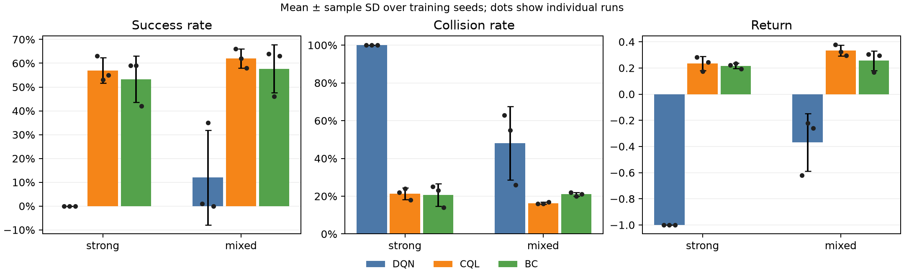
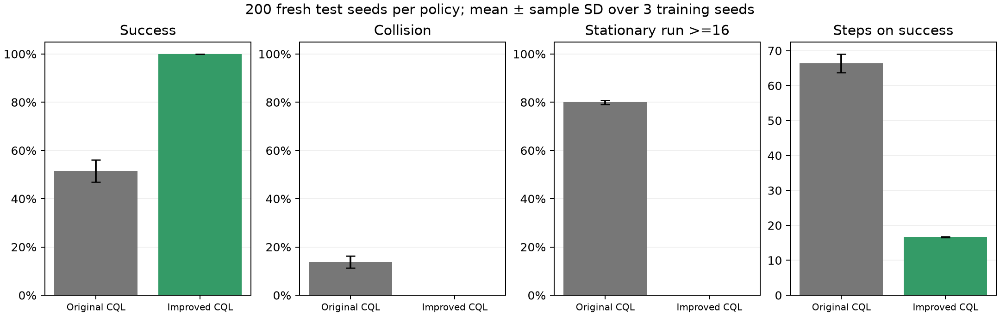

# cql-minigrid

Offline reinforcement learning for `MiniGrid-Dynamic-Obstacles-8x8-v0`:
PyTorch implementations of DQN, discrete Conservative Q-Learning (CQL), and
behavioral cloning (BC), with PPO experience collection and guided navigation
fine-tuning. The trained navigation agent and its recordings are included.

## Environment and algorithms

The observation contains the full symbolic 8×8 grid, direction, and normalized
elapsed time: 837 float32 values. Actions are left, right, and forward.
A normal step returns 0; reaching the goal returns
`1 - 0.9 * elapsed_steps / 256`. A blocked forward action terminates the
episode with reward -1. The time limit is 256 actions. Turning in place is a
legal action, so the original policies could spend many actions in one cell.

DQN and CQL use a 128–128 ReLU network, Adam at 0.0003, batch size 256,
gamma 0.99, Huber TD loss, and a target copy every 250 updates. Each original
run has 5,000 offline updates. CQL adds
`alpha * mean(logsumexp(Q(s, all_actions)) - Q(s, recorded_action))`;
DQN uses alpha 0. BC trains the same network with cross-entropy.
Both termination and time-limit truncation mask TD bootstrapping.
Offline updates use only recorded transitions.

The original study compares 200,035 strong PPO transitions and 200,019 mixed
transitions from final PPO, early PPO, and random actions. A second study
controls transition proportions and sweeps CQL alpha. Navigation fine-tuning
adds 50 geometry features derived from the existing observation, 50,012 guided
transitions, and a 0.005 training step cost. The deployed policy chooses a
network action directly; it does not call the demonstration planner.

## Results

The original comparison uses three training seeds and 100 common test episodes
per run. Values are mean ± sample SD across training seeds; they are not
confidence intervals. Successful steps are conditional on success; runs with
no successes are excluded from that column.

| Dataset | Method | Success % | Collision % | Timeout % | Return | Successful steps |
|---|---|---:|---:|---:|---:|---:|
| strong | DQN | 0.0 ± 0.0 | 100.0 ± 0.0 | 0.0 ± 0.0 | -1.000 ± 0.000 | — |
| strong | CQL | 61.7 ± 1.5 | 21.3 ± 1.2 | 17.0 ± 2.6 | 0.276 ± 0.004 | 58.6 ± 0.6 |
| strong | BC | 58.3 ± 5.0 | 22.3 ± 0.6 | 19.3 ± 5.1 | 0.239 ± 0.047 | 59.1 ± 3.6 |
| mixed | DQN | 15.7 ± 26.3 | 28.0 ± 11.1 | 56.3 ± 36.8 | -0.135 ± 0.146 | 21.1 ± 0.1 |
| mixed | CQL | 60.7 ± 6.1 | 13.3 ± 1.2 | 26.0 ± 6.0 | 0.357 ± 0.039 | 54.2 ± 6.9 |
| mixed | BC | 55.0 ± 4.6 | 19.0 ± 2.0 | 26.0 ± 5.6 | 0.248 ± 0.037 | 57.9 ± 3.4 |

CQL has the highest mean success in this comparison, but three seeds do not
establish general superiority. Final PPO achieved 62% on the same test seeds.
The episode-sampled mixed file contains 93.8% final-PPO transitions. With
transition-balanced weak data and alpha 1, CQL success falls to 2.7%; the
[alpha study](docs/ablation.md) reports the full sensitivity results.



The navigation improvement was selected on validation seeds 10000–10063,
then evaluated on fresh seeds 30000–30199. Each of three models uses the same
200 environment seeds. These test results did not select the configuration.

| Policy | Success % | Collision % | Timeout % | Stationary run ≥16 % | Successful actions |
|---|---:|---:|---:|---:|---:|
| Original mixed CQL | 51.50 ± 4.58 | 13.83 ± 2.52 | 34.67 ± 7.02 | 80.00 ± 0.87 | 66.40 ± 2.66 |
| Improved CQL | 100.00 ± 0.00 | 0.00 ± 0.00 | 0.00 ± 0.00 | 0.00 ± 0.00 | 16.68 ± 0.17 |

The selected checkpoint reaches the goal in 18 actions on demonstration seed
20000; the original takes 148, with 125 consecutive stationary actions.
The tested models succeeded in 600/600 evaluations across 200 distinct seeds.
This does not guarantee success on every possible environment seed.
Negative controls and the full protocol are in [navigation.md](docs/navigation.md).


[Improved MP4](reports/navigation/demos/improved.mp4) ·
[Original MP4](reports/navigation/demos/baseline.mp4) ·
[Detailed metrics](reports/navigation/summary.json)

## Installation

Run from the project root with **Python 3.12**:

```sh
python3.12 -m venv .venv
.venv/bin/python -m pip install torch==2.14.1 --index-url https://download.pytorch.org/whl/cpu
.venv/bin/python -m pip install -e '.[dev]'
.venv/bin/python -m cql_minigrid doctor
```

Dependencies are declared in `pyproject.toml`; training and evaluation use CPU.
`imageio-ffmpeg` supplies the video encoder. SDL can run headlessly with
`SDL_VIDEODRIVER=dummy` and Matplotlib with `MPLBACKEND=Agg`.

## Run the trained agent

The final distribution includes the selected checkpoint and evaluation config:

```sh
.venv/bin/python -m cql_minigrid replay --method cql --checkpoint artifacts/navigation-geometry/best.pt --format mp4 --output artifacts/manual/improved.mp4
.venv/bin/python -m cql_minigrid evaluate --method cql --checkpoint artifacts/navigation-geometry/best.pt --config artifacts/navigation-geometry/evaluation-config.json --output artifacts/manual/evaluation.json
```

Open `artifacts/manual/improved.mp4` to view the rollout. The first command uses
demonstration seed 20000; the second evaluates the 200 fresh test seeds.
The saved demonstration can also be viewed directly in
`reports/navigation/demos/improved.mp4` without installing Python.

## Validation and reproduction

```sh
.venv/bin/python -m pytest -q
.venv/bin/python -m cql_minigrid pipeline --config configs/smoke.json --root artifacts/check --reports artifacts/check/reports
```

The small configuration checks collection, offline training, evaluation, and
MP4/GIF export. It is a functional check, not a quality benchmark.
The tests cover rewards, ending flags, CQL loss and gradients, exact offline
resume, data integrity, metrics, portable paths, and navigation selection.
GitHub Actions also runs small alpha and guided-navigation studies.

Use fresh output directories to reproduce full experiments without changing
frozen results:

```sh
.venv/bin/python -m cql_minigrid pipeline --config configs/main.json --root artifacts/reproduction/main --workers 1 --reports artifacts/reproduction/main/reports
.venv/bin/python -m cql_minigrid ablation --config configs/ablation.json --root artifacts/reproduction/ablation --reports artifacts/reproduction/ablation/reports
.venv/bin/python -m cql_minigrid improve --config configs/navigation_geometry.json --root artifacts/reproduction/navigation --reports artifacts/reproduction/navigation/reports
# Review validation selection before opening the fresh test set.
.venv/bin/python -m cql_minigrid improve --config configs/navigation_geometry.json --root artifacts/reproduction/navigation --reports artifacts/reproduction/navigation/reports --finalize
```

The alpha and navigation configs refer to the included frozen input files under
`artifacts/final`, `artifacts/ablation`, and `artifacts/navigation-guided`.
To generate a new teacher dataset, use `guided-data` with
`configs/navigation_geometry.json` and a fresh root, then update the candidate
input paths in a copied configuration. `train --initialize-from` starts a new
optimizer from existing weights; `train --resume` restores optimizer and RNG
state for an interrupted run. Completed frozen datasets need no shard folders;
completed PPO collection needs `early.zip` and `final.zip`, not `latest.zip`.

Validation, historical test, fresh navigation test, and collection environment
seeds are separated and recorded. Offline CPU resume preserves RNG state
exactly. PPO resumes its optimizer but restarts environments, so it is not
bitwise equivalent to uninterrupted PPO training. Historical reports retain
the original training source hashes; documentation cleanup does not recompute
experiments or rewrite their measurements.

## Project layout

| Path | Contents |
|---|---|
| `src/cql_minigrid/` | Environment, PPO collector, datasets, offline learning, evaluation, studies, and CLI |
| `configs/` | Original study, smoke checks, alpha study, navigation, observation schema, and seeds |
| `tests/` | Numerical, integration, and reproducibility checks |
| `scripts/` | Report rendering, source audit, and release asset packaging |
| `docs/` | Proposal requirements and experimental protocols |
| `reports/` | Final tables, plots, audits, controls, and gameplay recordings |
| `artifacts/final/` | Original frozen datasets, two PPO checkpoints, 18 offline checkpoints, and full evaluations |
| `artifacts/ablation/` | Transition-balanced dataset, 39 study checkpoints, and full evaluations |
| `artifacts/navigation-guided/datasets/` | Frozen teacher NPZ and episode provenance |
| `artifacts/navigation-geometry/` | Six fine-tuned candidates, selected `best.pt`, selection, and fresh test results |

Datasets and weights are local artifacts excluded from source control.
For a source-only checkout, the original study and alpha study inputs can be
restored from the [artifacts-v1 release](https://github.com/SanyaLikeIT/cql-minigrid/releases/tag/artifacts-v1):
two PPO checkpoints, 57 offline checkpoints, and three frozen datasets.
That release predates the guided dataset and improved navigation checkpoints;
these are included in the final project distribution, not in that release.
`scripts/build_release_assets.py` verifies and packages the original artifacts.

Temporary builds, duplicate ZIPs, obsolete pilot runs, collection shards, and
personal work notes are excluded from the final distribution. Final evidence
and all checkpoints referenced by final reports are retained.

[Proposal requirements](docs/proposal_requirements.md) ·
[Transition-balanced data and alpha study](docs/ablation.md) ·
[Navigation protocol and controls](docs/navigation.md)
