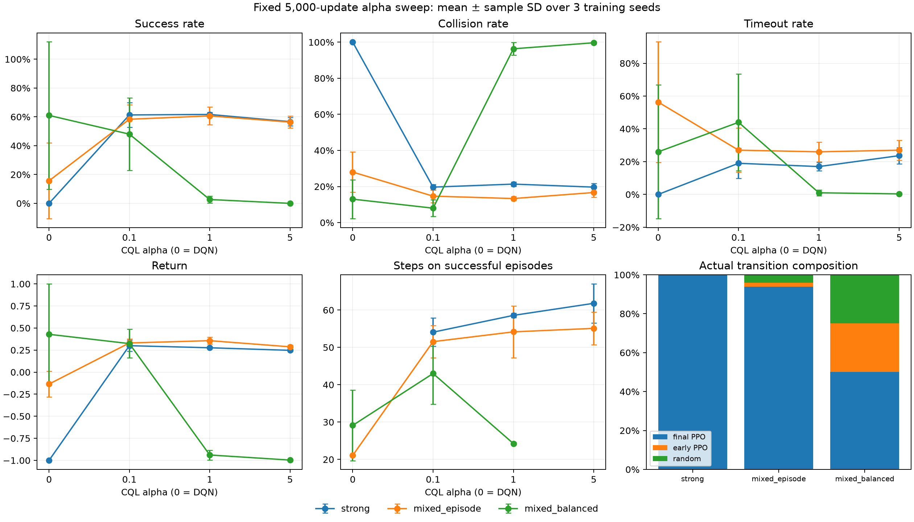

# Transition-balanced mixed data and alpha study

This document records the historical three-seed study. The current ten-seed
extension is documented in [reliability.md](reliability.md).

This follow-up retains the original proposal experiment and adds a stronger
control over the amount of weak data. It uses the same observation/reward
rules, PPO sources, 5,000-update offline budget, seeds 0/1/2, and test seeds
20000–20099. All alpha values were fixed before this sweep: **0, 0.1, 1, 5**.
The test results describe sensitivity; they do not select a new default alpha.

## Why a second mixed file

Selecting final/early/random with probabilities 50%/25%/25% per **episode**
produced 93.8% final-PPO transitions because its episodes were much longer.
The new `mixed_balanced` file controls **transition quotas** instead. Before
each complete episode the collector chooses the source with the largest
remaining transition quota. Collection stops at the first complete episode
after 200,000 total transitions. Small quota deviations are expected because
episodes are never cut or assigned fabricated timeouts. Shard resume restores
source counts and deterministic episode/policy seeds.

The file contains **200,025 transitions in 18,530 complete episodes**:

| Source | Transitions | Share | Episodes |
|---|---:|---:|---:|
| Final PPO | 100,065 | 50.0262% | 1,000 |
| Early PPO | 49,980 | 24.9869% | 11,911 |
| Random | 49,980 | 24.9869% | 5,619 |

Its SHA-256 is
`a8bd53c5daa2b65ff3d5443a707dc4f329429b66c885a7364203685f6f76fa62`.
Metadata explicitly records `sampling_unit: transitions`. Original episode
sampling remains the default, keeping old manifests and datasets compatible.
Collection uses a separate environment-seed range starting at 1200000 and
policy RNG range starting at 200120, with no test-seed overlap.

## Matched comparison

There are **36 CQL runs**: three files (`strong`, `mixed_episode`, and
`mixed_balanced`) × four alphas × three training seeds. Another **three BC
runs** provide a baseline on the new mixed file. `alpha=0` is the DQN control:
the loss, optimization, model initialization, targets, and sampling are
identical. Tests compare entire trained parameter tensors, in addition to
the existing loss/gradient equivalence checks. All final offline policies
in this study are trained afresh. Original proposal datasets remain intact.

The comparison keeps one PPO collector training seed and one frozen file per
condition. Changing the mixture also changes coverage, outcome frequencies,
and collected episodes. A transition-balanced mixture gives weak data much
more weight; it need not improve policy quality. Three training seeds and
one dataset realization do not establish general superiority or isolate a
causal effect of source quality. Conditional successful-episode lengths
exclude runs without successes; each aggregate records `valid_seeds`.

## Reproduce

First run the proposal pipeline from the repository root, or use its existing
artifacts included in the final distribution. Then reuse its exact PPO checkpoints:

```sh
mkdir -p artifacts/ablation
cp -a artifacts/final/ppo artifacts/ablation/
.venv/bin/python -m cql_minigrid collect --config configs/ablation.json --root artifacts/ablation
.venv/bin/python -m cql_minigrid ablation --config configs/ablation.json --root artifacts/ablation --reports reports/ablation
```

[configs/ablation.json](../configs/ablation.json) fixes alpha values, input files,
BC conditions, and training settings. [ablation_seeds.json](../configs/ablation_seeds.json)
fixes the collection and common evaluation seeds. The alpha runner uses one
CPU worker. Checkpoints are separate under
`artifacts/ablation/runs/{dataset}/cql-alpha-{alpha}/seed-{seed}.pt`;
BC has its own directory. Resume validates configuration, source hashes,
dataset hashes, and seed lists before continuing. Evaluation caches require
the matching checkpoint hash, test seeds, and metric version.

## Provenance without Git

`provenance()` anchors source hashes and Git queries to the loaded source
checkout rather than the caller's working directory. A missing `.git`, Git
executable, failed command, or timeout no longer prevents a run. Without an
accessible matching repository, `base_git_revision` is JSON `null`, with a
reason recorded; source SHA-256 values are always retained. A ZIP extracted
inside another repository cannot acquire that parent's SHA. Existing source
checkouts record clean/dirty state as well as their revision.

Regression tests cover a different working directory, an extracted project
nested in a parent checkout, unavailable Git, and timeouts. A full small
pipeline also runs from an actual source ZIP without `.git`, with six offline
runs and seven MP4/GIF pairs. GitHub Actions covers the regular smoke pipeline
and a small alpha study with all four alphas and BC.

## Measured results

All values below are mean ± sample SD over three training seeds, with all five
metrics computed on the same 100 test seeds per run. `alpha=0` is the DQN control.
The `—` entry denotes no successful episodes; conditional step means and SD use
only seeds with successes, whose counts are retained in the JSON.

| Dataset | Method | Alpha | Success % | Collision % | Timeout % | Return | Successful steps |
|---|---|---:|---:|---:|---:|---:|---:|
| mixed_balanced | BC | — | 0.0 ± 0.0 | 99.7 ± 0.6 | 0.3 ± 0.6 | -0.997 ± 0.006 | — |
| mixed_balanced | CQL | 0 | 61.0 ± 51.1 | 13.0 ± 10.8 | 26.0 ± 40.8 | 0.429 ± 0.574 | 29.1 ± 9.4 |
| mixed_balanced | CQL | 0.1 | 48.0 ± 25.2 | 8.0 ± 4.6 | 44.0 ± 29.6 | 0.323 ± 0.163 | 43.0 ± 8.2 |
| mixed_balanced | CQL | 1 | 2.7 ± 2.3 | 96.3 ± 3.5 | 1.0 ± 1.7 | -0.939 ± 0.055 | 24.2 ± 0.4 |
| mixed_balanced | CQL | 5 | 0.0 ± 0.0 | 99.7 ± 0.6 | 0.3 ± 0.6 | -0.997 ± 0.006 | — |
| mixed_episode | CQL | 0 | 15.7 ± 26.3 | 28.0 ± 11.1 | 56.3 ± 36.8 | -0.135 ± 0.146 | 21.1 ± 0.1 |
| mixed_episode | CQL | 0.1 | 58.3 ± 10.0 | 14.7 ± 3.5 | 27.0 ± 13.5 | 0.331 ± 0.046 | 51.5 ± 4.3 |
| mixed_episode | CQL | 1 | 60.7 ± 6.1 | 13.3 ± 1.2 | 26.0 ± 6.0 | 0.357 ± 0.039 | 54.2 ± 6.9 |
| mixed_episode | CQL | 5 | 56.3 ± 4.2 | 16.7 ± 2.5 | 27.0 ± 6.1 | 0.287 ± 0.020 | 55.1 ± 4.4 |
| strong | CQL | 0 | 0.0 ± 0.0 | 100.0 ± 0.0 | 0.0 ± 0.0 | -1.000 ± 0.000 | — |
| strong | CQL | 0.1 | 61.3 ± 8.5 | 19.7 ± 1.5 | 19.0 ± 9.2 | 0.300 ± 0.062 | 54.1 ± 3.8 |
| strong | CQL | 1 | 61.7 ± 1.5 | 21.3 ± 1.2 | 17.0 ± 2.6 | 0.276 ± 0.004 | 58.6 ± 0.6 |
| strong | CQL | 5 | 56.7 ± 2.9 | 19.7 ± 2.1 | 23.7 ± 4.9 | 0.247 ± 0.010 | 61.8 ± 5.3 |


Balanced-data DQN success rates by seed 0/1/2 are 91%, 90%, 2%. Its high mean
therefore comes with large training-seed variation. Stronger penalties do not
provide a uniform success improvement across these conditions. Default alpha 1
is retained; there is no test-set-based hyperparameter selection.

At alpha 1, changing the mixed file from episode sampling to transition quotas
changes mean success from 60.7% to 2.7%,
collision from 13.3% to 96.3%,
timeout from 26.0% to 1.0%,
and return from 0.357 to -0.939.
BC on balanced data has 0.0 ± 0.0% success.



[Per-run CSV](../reports/ablation/per_run.csv),
[compact JSON](../reports/ablation/summary.json),
[collection record](../reports/ablation/collection.json),
[runtime/session details](../reports/ablation/runtime.json), and
[artifact audit](../reports/ablation/integrity.json) provide counts, timings,
hashes, missing-success cases, and implementation provenance. Twelve control
runs at alpha 0/1 reproduced the original model parameters and metrics exactly.
The 29 jobs completed before an interruption retained their checkpoint hashes;
the partial next job resumed from its saved optimizer and RNG state. The final
session timer measures the resumed invocation, including cached-job validation,
not total wall time across both sessions. Update timers are cumulative per model.

### Balanced-data gameplay

All demonstrations use training seed 0 and test seed 20000. Sidecar JSON files
record original episode length, outcome, reward, checkpoint hash, and encoded
frames. GIFs show the same episodes as MP4s.

| Method | MP4 | Episode steps |
|---|---|---:|
| DQN (alpha 0) | [success](../reports/ablation/demos/mixed_balanced-cql-alpha-0.mp4) | 15 |
| CQL (alpha 1) | [collision](../reports/ablation/demos/mixed_balanced-cql-alpha-1.mp4) | 3 |
| BC | [collision](../reports/ablation/demos/mixed_balanced-bc.mp4) | 3 |
