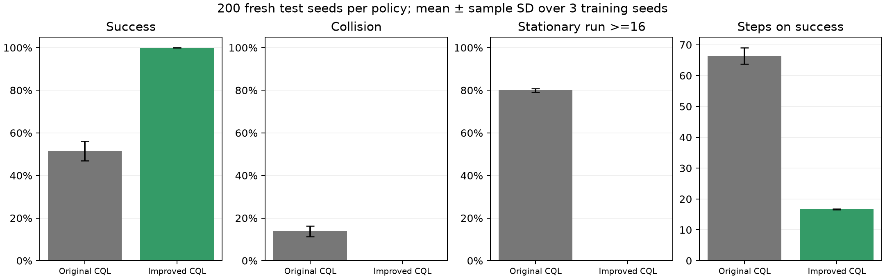

# Efficient CQL navigation

The original mixed CQL demonstration reaches the goal in 148 actions, including
125 consecutive turns in one cell. This follow-up improves the learned policy
while preserving the original environment, rewards, datasets, and reports.

## Changes

- `offline.step_penalty` subtracts a finite, nonnegative cost from every recorded
  training reward. Evaluation always uses the original rewards. BC rejects a
  nonzero penalty because its classification objective does not use rewards.
- `train --initialize-from` loads existing model weights into a new run with a
  fresh optimizer and target copy. `--resume` continues that new run, including
  optimizer and RNG state. Initial checkpoint and dataset hashes are checked.
- Optional `offline.navigation_features` adds 50 values computed only from the
  existing observation: object one-hots in four adjacent cells, goal displacement
  in world and agent coordinates, and agent coordinates. The input to the
  environment interface stays 837 values. New first-layer columns start at zero,
  retaining the old policy before fine-tuning. Old checkpoints still load.
- A BFS teacher replans a shortest path in position/direction space after each
  action. It produces a separate dataset. The deployed policy uses only the
  neural network's greedy action; it has no planner, collision mask, or forced
  escape action.
- Evaluation and replay metadata now include turn counts, stationary counts,
  and the longest stationary run. A stationary action changes no position;
  legal turns and waits count too. `stall_rate` is the fraction of episodes with
  at least 16 consecutive stationary actions, an operational diagnostic.

## Protocol and controls

All candidates initialize from the original mixed CQL checkpoint of the same
training seed (0, 1, or 2), with 5,000 additional updates, Adam at 0.0003,
batch size 256, gamma 0.99, target interval 250, and CQL alpha 1.

The investigation used validation seeds 10000–10063 only:

| Training data / features | Penalties | Mean validation success | Stationary-run rate |
|---|---|---:|---:|
| Original mixed, original features | 0 / 0.002 / 0.005 | 57.8 / 57.8 / 57.3% | 81.3 / 81.8 / 81.8% |
| Guided, original features | 0 / 0.002 / 0.005 | 43.8 / 45.3 / 39.6% | 0 / 0 / 0% |
| Guided, added geometry | 0 / 0.005 | 100 / 100% | 0 / 0% |

There are 24 fine-tuning runs in total. Eliminating stationary runs alone did not
improve navigation: guided data without geometry caused frequent collisions.
The penalty alone did not remove the original loops. The final improvement
combines demonstrations and geometry; it cannot be attributed to the step cost
alone. Validation successful lengths were 18.03 ± 0.04 actions without a step
cost and 17.82 ± 0.09 with a 0.005 cost (sample SD over training seeds).

The guided file contains **50,012 transitions in 2,905 complete episodes**,
starting with environment seed 1300000 and policy RNG seed 300120. All collected
episodes succeeded; mean length is 17.22. Teacher validation had 64/64 successes.
The frozen NPZ SHA-256 is
`c6bd55d6e7fd72492ce6d1e41e217292243b58dc7f5b5fc73dc404e5847b39f2`.
Teacher source hashes and episode provenance are in its JSON sidecar.

Selection requires mean validation success of at least 95%, no success regression
against baseline, and collision no more than two percentage points above baseline.
Eligible configurations minimize stationary-run rate, then successful length.
The representative checkpoint maximizes validation success, then minimizes
stationary-run rate and successful length. This selected penalty **0.005, seed 0**.

Only after selection was written did the runner open **fresh seeds 30000–30199**,
disjoint from validation, historical test, and collection environment seeds.
All three selected-configuration checkpoints and the three original checkpoints
use exactly the same 200 seeds. The test results did not select the configuration
or representative checkpoint, and no further model tuning followed this test.

## Fresh test results

Mean ± sample SD across three training seeds; each run has 200 episodes:

| Policy | Success % | Collision % | Timeout % | Stationary run ≥16 % | Successful actions | Return |
|---|---:|---:|---:|---:|---:|---:|
| Original mixed CQL | 51.50 ± 4.58 | 13.83 ± 2.52 | 34.67 ± 7.02 | 80.00 ± 0.87 | 66.40 ± 2.66 | 0.256 ± 0.010 |
| Improved CQL | 100.00 ± 0.00 | 0.00 ± 0.00 | 0.00 ± 0.00 | 0.00 ± 0.00 | 16.68 ± 0.17 | 0.941 ± 0.001 |

The selected seed-0 checkpoint succeeds on all 200 fresh episodes, averaging
16.68 actions. On historical demonstration seed 20000 it takes 18 actions,
including seven turns, with a maximum stationary run of five. Its original
counterpart takes 148 actions and has a stationary run of 125.



[Improved MP4](../reports/navigation/demos/improved.mp4),
[original MP4](../reports/navigation/demos/baseline.mp4),
[aggregate/per-run results](../reports/navigation/summary.json),
[negative controls](../reports/navigation/controls/), and
[audit](../reports/navigation/integrity.json) retain the measured evidence.
Full final-test episode records and the reported final checkpoints remain under
`artifacts/`. Intermediate control weights are excluded from the final
distribution; their compact results remain in `reports/navigation/controls/`.

These results cover one environment size, one guided dataset, three model
initializations, and 200 distinct fresh environment seeds. They do not establish
zero failures on every possible seed, obstacle configuration, or new environment.

## Reproduce

Install the Python 3.12 dependencies from the README. Download/extract the
original **models ZIP** if the original checkpoints are absent. The old datasets
ZIP is needed only for the original-mixed penalty controls.

From the project root, with fresh output directories:

```sh
.venv/bin/python -m cql_minigrid guided-data --config configs/navigation_geometry.json --root artifacts/navigation-guided
.venv/bin/python -m cql_minigrid improve --config configs/navigation_geometry.json --root artifacts/navigation-geometry --reports reports/navigation
# Inspect validation selection before opening the fresh test set.
.venv/bin/python -m cql_minigrid improve --config configs/navigation_geometry.json --root artifacts/navigation-geometry --reports reports/navigation --finalize
.venv/bin/python scripts/render_navigation.py
```

The validated candidate is saved as `artifacts/navigation-geometry/best.pt`;
`best.json` identifies its original path and checksum. `evaluation-config.json`
selects the fresh test seeds for ordinary CLI evaluation. `final.json` locks the
selection after testing. Resuming preserves final results and never retrains a
completed run. Configuration, data, initialization, and numerical training or
evaluation source changes are rejected. Reporting/orchestration fixes may resume
with their current hashes recorded separately from the original training sources.

The exploratory controls are defined by `configs/navigation.json` and
`configs/navigation_guided.json`. Their frozen summaries remain in
`reports/navigation/controls/`; intermediate weight dumps are not distributed.
Reproduce a control with `improve` and a fresh output root, without `--finalize`.
The rejected guided control leaves its test set unopened. Historical source
fingerprints are retained in these reports.
